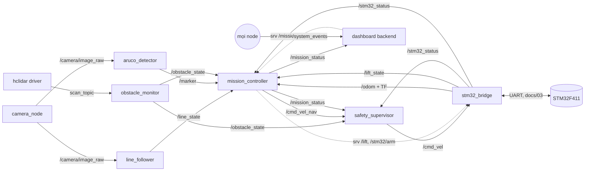

# 02 — HỢP ĐỒNG GIAO TIẾP (Interfaces Contract)

> Đây là **hợp đồng** giữa mọi module. Mọi code phải khớp tài liệu này.
> **Không tự ý đổi** tên topic, service, message, field, frame, đơn vị, thứ tự bánh hay tên tham số.
> Quy trình đổi: đề xuất → chủ dự án đồng ý → sửa tài liệu này + `07_decisions.md` → mới sửa code.
> File định nghĩa thật: `ros2_ws/src/agv_interfaces/msg/*.msg`, `srv/*.srv`.

---

## 1. Quy ước chung

| Mục | Quy ước |
|---|---|
| Hệ trục | REP-103: **x tiến**, **y sang trái**, z lên; góc và `wz` **dương = ngược chiều kim đồng hồ (CCW)** |
| Frames | REP-105: `odom` → `base_link` (stm32_bridge publish TF); `base_link` → `laser`, `camera_link`, `imu_link` (static TF do bringup publish từ `hardware_params.yaml`) |
| `base_link` | Tâm hình chữ nhật tạo bởi 4 điểm tiếp đất của bánh, z = mặt sàn |
| Đơn vị | SI: m, m/s, rad, rad/s, s. Firmware dùng thêm: rpm, step, ms, ‰ (PWM). Vị trí lift trong ROS: mm (`position_mm`) và step (`position_steps`) |
| **Thứ tự bánh** | **index 0 = FL, 1 = FR, 2 = RL, 3 = RR** ở MỌI nơi: mảng, UART payload, DB columns, log |
| Tọa độ ảnh | Chuẩn hóa [0, 1]; x = 0 mép trái, y = 0 mép trên. Ảnh xử lý 320×240 |
| `lateral_error` (line) | [-1, 1]; **dương = line nằm BÊN TRÁI** đường tâm ảnh (khớp +y) |
| `heading_error` (line) | rad; **dương = line quay CCW (rẽ trái)** so với trục +x của robot |
| Thời gian | `header.stamp` = thời điểm đo (ảnh chụp, scan, telemetry nhận). Dùng ROS time, không dùng `time.time()` để so sánh stale |
| Ngôn ngữ code | Tên biến/hàm/class/comment kỹ thuật: tiếng Anh |

### 1.1 Động học mecanum (mặc định, PHẢI xác nhận bằng test — docs/06 §Drive)

Với `lx` = wheelbase/2, `ly` = track_width/2, `r` = bán kính bánh, ω = rad/s tại bánh. Công thức dưới là cho bố trí con lăn phổ biến; nếu test strafe cho kết quả ngược thì đảo dấu theo `mecanum_roller_layout`, **không** sửa tay từng chỗ.

```text
Inverse:  ω_FL = (vx − vy − (lx+ly)·wz) / r      Forward:  vx = r/4 · ( ω_FL + ω_FR + ω_RL + ω_RR)
          ω_FR = (vx + vy + (lx+ly)·wz) / r                vy = r/4 · (−ω_FL + ω_FR + ω_RL − ω_RR)
          ω_RL = (vx + vy − (lx+ly)·wz) / r                wz = r/(4(lx+ly)) · (−ω_FL + ω_FR − ω_RL + ω_RR)
          ω_RR = (vx − vy + (lx+ly)·wz) / r
```
Dấu chiều quay thực tế của từng động cơ/encoder được bù bằng `motor_direction_sign[]`, `encoder_direction_sign[]` — công thức trên luôn tính trong "không gian bánh lý tưởng".

---

## 2. Sơ đồ node



**Một đường lệnh duy nhất tới động cơ:** `mission_controller → /cmd_vel_nav → safety_supervisor → /cmd_vel → stm32_bridge → UART`.
Không node nào khác được publish `/cmd_vel` hoặc `/cmd_vel_nav`. Dashboard không bao giờ gửi vận tốc.

---

## 3. Bảng topic

| Topic | Kiểu | Publisher (duy nhất) | Subscriber | Tần số | QoS |
|---|---|---|---|---|---|
| `/camera/image_raw` | sensor_msgs/Image (bgr8) | camera_node | line_follower, aruco_detector | 30 Hz | SENSOR |
| `/line_debug/image` | sensor_msgs/Image | line_follower (khi `publish_debug_image`) | rqt / dashboard | ≤ 10 Hz | SENSOR |
| `/line_state` | agv_interfaces/LineState | line_follower | mission_controller, dashboard | theo fps camera | STATE |
| `/marker` | agv_interfaces/MarkerState | aruco_detector | mission_controller, dashboard | theo frame xử lý | STATE |
| `<hw: lidar.scan_topic>` | sensor_msgs/LaserScan | hclidar driver | obstacle_monitor | `lidar.scan_rate_hz` | SENSOR |
| `/obstacle_state` | agv_interfaces/ObstacleState | obstacle_monitor | mission_controller, safety_supervisor, dashboard | mỗi scan | STATE |
| `/cmd_vel_nav` | geometry_msgs/Twist | mission_controller | safety_supervisor | 20 Hz (liên tục, kể cả 0) | STATE |
| `/cmd_vel` | geometry_msgs/Twist | safety_supervisor | stm32_bridge | 20 Hz (liên tục) | STATE |
| `/safety_status` | agv_interfaces/SafetyStatus | safety_supervisor | mission_controller, dashboard | 20 Hz | STATE |
| `/odom` | nav_msgs/Odometry | stm32_bridge | mission_controller, dashboard | 50 Hz | STATE |
| TF `odom→base_link` | tf2 | stm32_bridge | — | 50 Hz | — |
| `/imu/data` | sensor_msgs/Imu | stm32_bridge (nếu `imu.connected_to = STM32_I2C`) | (tùy chọn) | 50 Hz | SENSOR |
| `/motor_state` | agv_interfaces/MotorState | stm32_bridge | dashboard | 20 Hz | STATE |
| `/lift_state` | agv_interfaces/LiftState | stm32_bridge | mission_controller, dashboard | 10 Hz + khi đổi | STATE |
| `/stm32_status` | agv_interfaces/Stm32Status | stm32_bridge | safety_supervisor, mission_controller, dashboard | 10 Hz | STATE |
| `/mission_status` | agv_interfaces/MissionStatus | mission_controller | safety_supervisor, dashboard | 5 Hz + mỗi transition | STATE |
| `/system_events` | agv_interfaces/SystemEvent | mọi node | dashboard (→ DB) | theo sự kiện | EVENT |

## 4. Bảng service

| Service | Kiểu | Server | Client được phép | Ghi chú |
|---|---|---|---|---|
| `/lift` | agv_interfaces/srv/Lift | stm32_bridge | **chỉ mission_controller** | Trả lời ngay (accepted/rejected + request_id); hoàn thành theo dõi trên `/lift_state` |
| `/stm32/arm` | std_srvs/srv/Trigger | stm32_bridge | **chỉ mission_controller** | Gửi `CMD_ARM`; chờ `ACK` (timeout 0.5 s) |
| `/stm32/set_pid` | agv_interfaces/srv/SetWheelPid | stm32_bridge | CLI khi tuning | Gửi `CMD_SET_PID`; không lưu vĩnh viễn |
| `/mission/command` | agv_interfaces/srv/MissionCommand | mission_controller | dashboard backend, CLI | Ma trận chấp nhận lệnh: docs/04 §D.3 |

**Không service callback nào được block chờ một service khác** (dùng `call_async` + callback / MultiThreadedExecutor + callback group riêng).

---

## 5. Định nghĩa hình học dùng cho LiDAR (obstacle_monitor)

Mọi điểm scan được chuyển sang `base_link` bằng vị trí lắp trong `hardware_params.yaml` (lidar.mount_*). Ký hiệu: `F` = x mép trước, `R` = x mép sau, `W/2` = nửa bề rộng, `Lx` = x của lidar.

| Vùng | Định nghĩa |
|---|---|
| Self-filter | Bỏ điểm nằm trong footprint + `self_filter_margin_m`, và điểm trong `lidar.blocked_angle_ranges_deg` |
| Front zone | Điểm có x > F **và** (nằm trong sector ±`front_half_angle_deg` tính từ lidar **hoặc** \|y\| ≤ W/2 + `front_corridor_margin_m`). Hành lang thẳng phía trước bù cho chỗ hở của sector ±30° ở cự ly gần góc xe |
| `front_min_distance` | min(x − F) trên các điểm front zone; = `range_max` nếu không có điểm |
| `raw_zone` | STOP nếu có ≥ `min_obstacle_points` điểm với khoảng cách < `stop_distance_m`; SLOW nếu < `slow_distance_m`; ngược lại CLEAR |
| `zone` | Tăng mức (CLEAR→SLOW→STOP) sau `zone_persistence_scans` scan liên tiếp; giảm mức sau `clear_hysteresis_scans` scan liên tiếp |
| `left_free` | Không có điểm trong hộp x ∈ [Lx, F + `side_corridor_ahead_m`], y ∈ [W/2 + margin, W/2 + `side_clearance_required_m`] |
| `right_free` | Đối xứng với y âm |
| `obstacle_beside_left/right` | Có điểm trong x ∈ [Lx, F], \|y\| ∈ [W/2, W/2 + `beside_band_width_m`] |
| `rotation_clear` | Không có điểm cách gốc `base_link` < √((L/2)² + (W/2)²) + `rotation_margin_m` |
| Vùng mù | Lidar gắn giữa mặt trước, giữa 2 tầng ⇒ **không nhìn thấy phía sau x = Lx** (thân xe che). Mọi logic "đã vượt qua vật cản" phải dùng odometry cho phần mù này (docs/04 §D.5 PASS) |

---

## 6. File tham số

| File | Định dạng | Nội dung | Ai đọc |
|---|---|---|---|
| `config/agv_params.yaml` | ROS 2 `ros__parameters` (có `/**`) | Tham số tinh chỉnh/chính sách, tên = hợp đồng | Mọi node qua launch |
| `config/hardware_params.yaml` | YAML thường (cho phép `null`) | Thông số phần cứng, nguồn sự thật duy nhất | `agv_common.hw_params` (Python), generator header firmware |
| `config/station_map.yaml` | YAML thường | Bảng ID ArUco → trạm, hành động, stop offset | aruco_detector, mission_controller, dashboard backend |
| `config/firmware_params.yaml` | YAML thường | Chính sách firmware (watchdog, ramp, phát hiện lỗi bánh, tần số telemetry) | generator `agv_config.h` |

Quy tắc:
- Đường dẫn: launch đọc biến môi trường `AGV_CONFIG_DIR` (mặc định `<repo>/config`) và điền `hardware_params_file`, `station_map_file`.
- Tên tham số trong `agv_params.yaml` là hợp đồng; thêm tham số mới thì thêm vào file này (với giá trị mặc định + comment), không declare "ẩn" trong code.
- Loader `hardware_params` phải **fail-fast** liệt kê mọi trường `null` mà node cần khi `sim_mode: false`.
- Không hard-code bất kỳ ngưỡng, khoảng cách, thời gian, hệ số PID, HSV, timeout nào trong source.

## 7. QoS

| Profile | Định nghĩa | Dùng cho |
|---|---|---|
| SENSOR | `rclpy.qos.qos_profile_sensor_data` (BEST_EFFORT, KEEP_LAST 5) | ảnh, scan, imu |
| STATE | RELIABLE, KEEP_LAST 10, VOLATILE | trạng thái, lệnh vận tốc |
| EVENT | RELIABLE, KEEP_LAST 100, VOLATILE | `/system_events` |

Subscriber cho topic của driver bên ngoài (lidar) dùng SENSOR (BEST_EFFORT tương thích với cả publisher RELIABLE). Định nghĩa các profile ở một chỗ (`agv_common.qos`).

## 8. Quy tắc dữ liệu cũ (stale)

| Dữ liệu | Ngưỡng (param) | Hậu quả |
|---|---|---|
| `/cmd_vel_nav` (thời điểm nhận) | `safety_supervisor.cmd_timeout_s` = 0.3 s | supervisor xuất 0 |
| `/obstacle_state` (header.stamp) | 0.3 s (`obstacle_timeout_s`, `obstacle_state_timeout_s`) | supervisor xuất 0; mission → ERROR nếu đang di chuyển |
| `/stm32_status` | 0.5 s | supervisor xuất 0 |
| `/line_state` | `mission_controller.line_state_timeout_s` = 0.3 s | mission → ERROR (camera chết) nếu đang ở trạng thái dùng line |
| `/odom` | 0.2 s | mission → ERROR nếu đang di chuyển |
| `/mission_status` | 1.0 s | supervisor coi như `loaded = true` (bảo thủ) |
| UART link | `stm32_bridge.link_timeout_s` = 0.5 s | `Stm32Status.link_ok = false` |
| Lệnh vận tốc tới STM32 | 300 ms (firmware watchdog) | STM32 dừng động cơ, FAULT latched |

## 9. Danh mục sự kiện `/system_events`

`event_type` chỉ được lấy từ danh sách sau (thêm mới phải cập nhật bảng này):

| sensor_type | event_type | severity mặc định |
|---|---|---|
| LIDAR | `LIDAR_STOP`, `LIDAR_SLOW`, `LIDAR_CLEAR` | WARNING / INFO / INFO |
| LIDAR | `LIDAR_STALE`, `LIDAR_OK` | ERROR / INFO |
| CAMERA | `CAMERA_OFFLINE`, `CAMERA_ONLINE` | ERROR / INFO |
| CAMERA | `LINE_LOST`, `LINE_FOUND`, `CORNER_DETECTED` | WARNING / INFO / INFO |
| CAMERA | `ARUCO_DETECTED` (khi confirmed) | INFO |
| IMU | `IMU_ERROR` | WARNING |
| ENCODER | `ENCODER_FAULT` | ERROR |
| STM32 | `STM32_LINK_LOST`, `STM32_LINK_OK`, `STM32_FAULT`, `STM32_ARMED` | CRITICAL / INFO / ERROR / INFO |
| STM32 | `ESTOP_PRESSED`, `ESTOP_RELEASED` | CRITICAL / INFO |
| LIFT | `LIFT_DONE`, `LIFT_ERROR` | INFO / ERROR |
| MISSION | `MISSION_STARTED`, `MISSION_COMPLETED`, `MISSION_CANCELLED`, `MISSION_FAILED` | INFO / INFO / WARNING / ERROR |
| MISSION | `DETOUR_STARTED`, `DETOUR_COMPLETED`, `STATION_REACHED` | INFO |
| MISSION | `COMMAND_ACCEPTED`, `COMMAND_REJECTED` | INFO / WARNING |
| SAFETY | `MOTION_INHIBITED`, `MOTION_RESTORED` | WARNING / INFO |

Chống spam: cùng `event_type` từ cùng `source` không gửi lại trong 1 s trừ khi giá trị trạng thái đổi.

## 10. Package và quyền sở hữu

| Package (ros2_ws/src) | Loại | Nội dung |
|---|---|---|
| `agv_interfaces` | ament_cmake | msg/srv (**đã có sẵn**) |
| `agv_common` | ament_python | `hw_params` loader (fail-fast), `qos`, `station_map` loader, tiện ích stale/time, hằng số chung |
| `agv_bridge` | ament_python | node `stm32_bridge`, `protocol.py` (phải pass `tools/protocol_vectors.json`), `sim_stm32` (giả lập STM32 để test) |
| `agv_vision` | ament_python | node `camera_node`, `line_follower`, `aruco_detector`; thư viện **không phụ thuộc ROS**: `line_detector.py`, `aruco_tracker.py` |
| `agv_safety` | ament_python | node `obstacle_monitor`, `safety_supervisor`; thư viện không phụ thuộc ROS: `scan_geometry.py`, `cmd_gate.py` |
| `agv_mission` | ament_python | node `mission_controller`; thư viện không phụ thuộc ROS: `state_machine.py`, `controllers.py`, `mission_model.py` |
| `agv_bringup` | ament_python | `launch/agv.launch.py`, static TF từ hardware params, systemd unit mẫu |

Ngoài ros2_ws: `firmware/` (STM32), `dashboard/backend` (FastAPI + rclpy monitor), `dashboard/frontend` (React + TS), `database/` (schema.sql).

Quy tắc thiết kế: logic thuật toán nằm trong thư viện thuần Python (test bằng pytest không cần ROS); node ROS chỉ là lớp vỏ mỏng (param, pub/sub, timer).

## 11. Ánh xạ sang Dashboard / Database (Module 8)

| Nguồn | Bảng / màn hình |
|---|---|
| `/odom` + `/motor_state` (lấy mẫu theo `telemetry_logging_rate`) | `telemetry` (cột `front_left_rpm`… theo thứ tự FL, FR, RL, RR) |
| `/mission_status` (mỗi lần `state` đổi) | `mission_events` (`previous_state`, `current_state`) |
| `/mission_status` (mission_id, start/end) | `missions` |
| `/system_events` | `sensor_events` (severity ≥ ERROR cũng ghi `system_errors`) |
| `/lift_state` (mỗi lệnh hoàn tất/lỗi) | `lift_logs` |
| `/mission/command` từ dashboard | `command_logs` (audit, ghi cả lệnh bị từ chối) |
| `config/station_map.yaml` | API `/api/agv/config/stations` → ArUco Monitor (không hard-code mapping ở frontend) |
