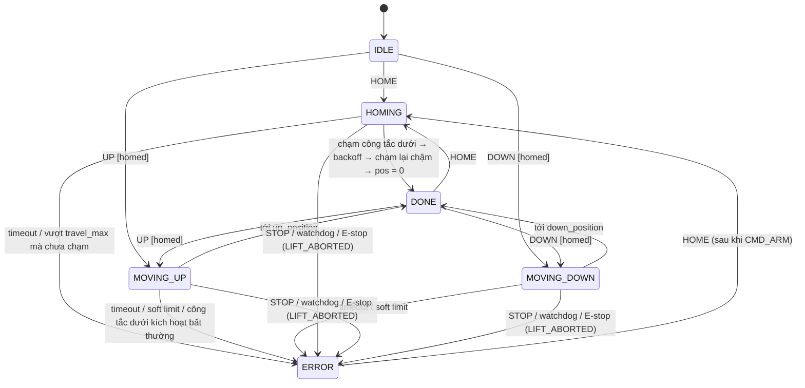
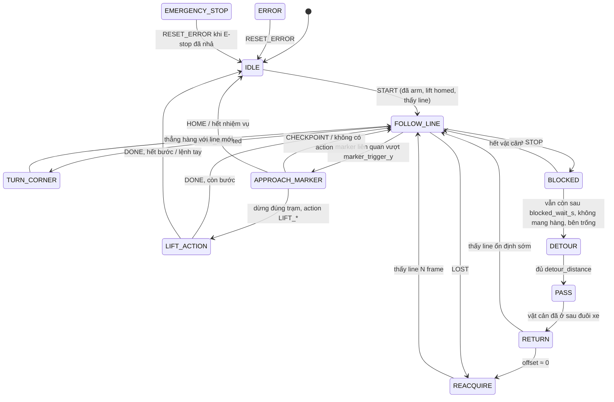

# 04 — STATE MACHINES & LOGIC ĐIỀU KHIỂN (Contract)

> Viết code đúng theo bảng chuyển trạng thái ở đây. State machine phải là cấu trúc tường minh (bảng/transition table hoặc class mỗi state), **không** dùng if lồng nhau không kiểm soát. Mọi ngưỡng/thời gian là tham số trong `config/agv_params.yaml`.

---

## A. Firmware — system mode
Xem `docs/03_uart_protocol.md §6` (STOPPED / RUNNING / FAULT, watchdog 300 ms, `CMD_ARM`, interlock lift↔drive).

Bổ sung cho firmware:
- Vòng điều khiển 10 ms (100 Hz) chạy từ ngắt timer: đọc encoder → tính rpm → PID → PWM. Không làm việc nặng trong ngắt (parse UART, gửi telemetry ở main loop).
- Dừng an toàn: PWM = 0 ở chế độ brake (DRV8871: IN1 = IN2 = 1) trong `stop_brake_ms`, sau đó coast. Giới hạn gia tốc (ramp) khi tăng tốc; khi dừng vì lỗi thì dừng ngay.
- Phát hiện lỗi bánh: |PWM| > `wheel_fault_pwm_min` và |rpm| < `wheel_fault_rpm_max` liên tục > `wheel_fault_time_ms` → `WHEEL_FAULT_x`.
- Mọi hằng số firmware nằm trong `firmware/core/inc/agv_config.h`, sinh từ `config/hardware_params.yaml` (thông số đo) + `config/firmware_params.yaml` (chính sách: `stop_brake_ms`, `wheel_fault_*`, ramp, timeout…), không rải số trong code.

## B. Firmware — Lift state machine

| Quy tắc | Chi tiết |
|---|---|
| Homing | Nếu công tắc đã kích hoạt lúc bắt đầu: đi lên `homing_backoff_mm` trước. Đi xuống tốc độ `homing_speed_mm_s`; chạm công tắc → dừng → lên `homing_backoff_mm` → xuống chậm (½ tốc độ) tới khi chạm → pos = 0 → `homed = true` → DONE |
| Soft limit | Vị trí luôn trong [0, `travel_max_mm`]; lệnh vượt → từ chối/ERROR `LIFT_SOFT_LIMIT` |
| Timeout | Mỗi chuyển động: `timeout = quãng đường / tốc độ × timeout_factor + timeout_margin_s` (`config/firmware_params.yaml`) |
| Sau ERROR | `homed = false` (không tin vị trí nữa), bắt buộc HOME lại |
| Profile | Tăng/giảm tốc dạng hình thang để stepper không mất bước |
| `DONE` | Trạng thái "kết quả cuối" — giữ đến lệnh kế tiếp |

## C. Safety supervisor — luật chặn lệnh (`agv_safety/cmd_gate.py`)

Chạy ở `output_rate_hz` (20 Hz), **luôn** publish `/cmd_vel` (kể cả 0) và `/safety_status`. Áp dụng tuần tự:

| # | Điều kiện | Kết quả | Reason |
|---|---|---|---|
| 1 | `/cmd_vel_nav` cũ hơn `cmd_timeout_s` | xuất 0 | CMD_STALE |
| 2 | `/obstacle_state` cũ hoặc `sensor_ok = false` | xuất 0 | OBSTACLE_DATA_STALE |
| 3 | `/stm32_status` cũ, `link_ok = false`, `mode ≠ RUNNING` | xuất 0 | STM32_NOT_READY |
| 4 | `estop_active` | xuất 0 | ESTOP |
| 5 | vx > 0 và zone = STOP | vx = 0 | OBSTACLE_STOP |
| 6 | vx > 0 và zone = SLOW | vx = min(vx, `slow_vx`) | OBSTACLE_SLOW |
| 7 | vx < 0 | `allow_reverse=false` → vx = 0; ngược lại clamp `max_reverse_vx` (lidar không thấy phía sau) | REVERSE_BLOCKED |
| 8 | vy > 0 và `!left_free`; vy < 0 và `!right_free` | vy = 0 | SIDE_BLOCKED |
| 9 | wz ≠ 0 và `!rotation_clear` | wz = 0 | ROTATION_BLOCKED |
| 10 | clamp `max_vx/vy/wz`; nếu `loaded` (hoặc `/mission_status` cũ) nhân `loaded_speed_scale` | | SPEED_LIMITED |
| 11 | Giới hạn gia tốc chỉ áp dụng khi **tăng** \|v\|; **giảm** \|v\| (dừng) luôn tức thì | | |

Supervisor không có trạng thái nhiệm vụ; nó chỉ là bộ lọc. Không có cơ chế "bỏ qua" (override) nào.

## D. Mission controller

### D.1 Trạng thái

| State | Mục đích | Lệnh vận tốc |
|---|---|---|
| IDLE | Chờ lệnh | 0 |
| FOLLOW_LINE | Bám line, theo dõi marker/góc/vật cản | bộ điều khiển line |
| TURN_CORNER | Qua góc vuông 90° | tiến `corner_advance_distance_m` rồi quay tại chỗ |
| APPROACH_MARKER | Giảm tốc, tiến thêm offset tới đúng trạm | line ở `approach_speed` |
| LIFT_ACTION | Nâng/hạ/home | 0 |
| BLOCKED | Có vật cản phía trước | 0 |
| DETOUR | Strafe sang bên để né | vy, giữ hướng |
| PASS | Đi thẳng song song line qua vật cản | vx, giữ hướng |
| RETURN | Strafe về lại line | vy ngược, giữ hướng |
| REACQUIRE | Tìm lại line | vx chậm, giữ hướng |
| PAUSED | Tạm dừng theo lệnh | 0 |
| ERROR | Lỗi, chờ người vận hành | 0 |
| EMERGENCY_STOP | E-stop phần cứng đang/đã nhấn | 0 |

### D.2 Thứ tự kiểm tra mỗi chu kỳ (`control_rate_hz`)

1. `stm32_status.estop_active` → **EMERGENCY_STOP**.
2. `stm32_status` cũ / `link_ok = false` / `mode = FAULT` (khi đang không ở IDLE/ERROR/EMERGENCY_STOP) → **ERROR** (`STM32_FAULT` / `STM32_LINK_LOST`).
3. Đang ở state có chuyển động mà dữ liệu cần thiết cũ (odom; obstacle; line với FOLLOW_LINE/APPROACH/TURN/REACQUIRE) → **ERROR** (`SENSOR_STALE_*`).
4. Ở FOLLOW_LINE / APPROACH_MARKER / REACQUIRE / TURN_CORNER (pha tiến) mà `zone = STOP` hoặc `!sensor_ok` → **BLOCKED** (lưu `return_state`).
5. Logic riêng của state hiện tại.
6. Publish `/cmd_vel_nav` (luôn luôn), `/mission_status` (theo `status_rate_hz` + mỗi lần chuyển).

`zone = SLOW` không cần mission xử lý: supervisor tự giới hạn tốc độ.

### D.3 Lệnh `/mission/command` — ma trận chấp nhận

| Lệnh | Chấp nhận ở | Điều kiện | Kết quả |
|---|---|---|---|
| START | IDLE | lift homed; thấy line (confidence ≥ `min_line_confidence`); `/stm32/arm` thành công; station hợp lệ trong station_map | FOLLOW_LINE |
| GO_HOME | IDLE | như START | mission GO_HOME → FOLLOW_LINE |
| PAUSE | FOLLOW_LINE, TURN_CORNER, APPROACH_MARKER, LIFT_ACTION, BLOCKED, DETOUR, PASS, RETURN, REACQUIRE | — | PAUSED (lưu `resume_state` + ngữ cảnh; nếu LIFT_ACTION thì gửi lift STOP) |
| RESUME | PAUSED | không có lỗi đang hoạt động | về `resume_state` (reset timer state; giữ pose gốc của DETOUR; LIFT_ACTION gửi lại lệnh lift) |
| CANCEL | mọi state trừ ERROR, EMERGENCY_STOP | — | IDLE; mission → CANCELLED; lift STOP nếu đang chạy |
| LIFT_UP / LIFT_DOWN / LIFT_HOME | IDLE | robot đứng yên; arm nếu cần | LIFT_ACTION (manual) → IDLE |
| RESET_ERROR | ERROR, EMERGENCY_STOP | E-stop đã nhả; link STM32 OK | IDLE (mission bị hủy; arm lại khi START) |

Mọi lệnh (chấp nhận hoặc từ chối) đều phát `/system_events` (`COMMAND_ACCEPTED` / `COMMAND_REJECTED`) kèm `requested_by`.

### D.4 Mô hình nhiệm vụ

| Loại | Danh sách bước |
|---|---|
| TRANSPORT | `[GOTO pickup → LIFT_UP, GOTO dropoff → LIFT_DOWN, (GOTO HOME nếu return_home)]` |
| GO_HOME | `[GOTO HOME]` |
| PATROL | Không có đích: mỗi marker gặp được thực hiện `default_action` (LIFT_UP chỉ khi chưa mang hàng, LIFT_DOWN chỉ khi đang mang hàng; ngược lại bỏ qua + event) |

- Marker "liên quan" = station của bước hiện tại (TRANSPORT/GO_HOME) hoặc mọi marker có action (PATROL). Marker không liên quan: cập nhật `current_station`, phát `STATION_REACHED`, đi tiếp.
- `loaded` = true sau LIFT_UP DONE, false sau LIFT_DOWN DONE (v1; load cell để sau).
- Giả định v1: **tuyến line không có ngã ba/nhánh**. Ngã ba cần marker chỉ hướng (v2).

### D.5 Chi tiết từng state

**FOLLOW_LINE**
- `line_control_mode = "wz_only"` (mặc định): `vx = follow_speed`, `wz = PID(lateral_error + line_heading_weight·heading_error)` (dấu: lỗi dương = line bên trái → wz dương = quay trái), `vy = 0`.
- `"vy_wz"`: `vy = line_kp_vy·lateral_error`, `wz = PID(heading_error)`. Chỉ bật sau khi đã test riêng.
- `status = RECOVERING` (gãy line ngắn): giữ wz cuối (không tích phân thêm), tốc độ × `recovering_speed_scale`.
- `status = LOST` → REACQUIRE.
- `corner_detected` → TURN_CORNER(direction).
- Marker liên quan, chưa bị khóa, đã confirmed và `center_y ≥ marker_trigger_y` → APPROACH_MARKER.

**TURN_CORNER** (góc vuông — tuyến thực tế có góc 90°)
- Pha ADVANCE: giữ hướng lúc vào, tiến `corner_advance_distance_m` (≈ khoảng từ vùng nhìn gần của camera tới tâm xe, phải hiệu chỉnh).
- Pha ROTATE: `wz = direction · turn_speed` (supervisor kiểm `rotation_clear`) đến khi line `found`, `confidence ≥ min` và \|heading_error\| < `turn_align_tolerance_rad` → FOLLOW_LINE.
- Góc đã quay > `turn_max_angle_rad` → ERROR `TURN_OVERSHOOT`; quá `turn_timeout_s` → ERROR `TURN_TIMEOUT`.

**APPROACH_MARKER**
- Lưu pose lúc vào. Bám line với `approach_speed`. Khi quãng đường ≥ `stop_offset_m` (của station, hoặc mặc định) → lệnh 0 → chờ đứng yên (\|v\| < `stopped_velocity_eps` trong `stopped_settle_s`).
- Sau đó theo action: LIFT_UP / LIFT_DOWN → LIFT_ACTION; HOME → mission COMPLETED → IDLE; CHECKPOINT/không liên quan → khóa marker → FOLLOW_LINE.
- Quá `approach_timeout_s` → ERROR `APPROACH_TIMEOUT`.

**Khóa marker**: sau khi xử lý ID X, bỏ qua X cho tới khi X không còn được phát hiện trong `marker_relock_time_s` **và** robot đã đi ≥ `marker_relock_distance_m`.

**LIFT_ACTION**
- Yêu cầu robot đứng yên. Gọi `/lift` (async). `accepted = false` → ERROR `LIFT_REJECTED`.
- Chờ `/lift_state` có `request_id` trùng: DONE → cập nhật `loaded` → bước kế tiếp; ERROR → ERROR `LIFT_ERROR`; quá `lift_action_timeout_s` → gửi lift STOP → ERROR `LIFT_TIMEOUT`.

**BLOCKED**
- Lệnh 0, ghi thời điểm vào. Zone hết STOP (đã lọc hysteresis) → về `return_state`.
- Sau `blocked_wait_s` mà vẫn STOP: nếu `loaded` hoặc `!detour_enabled` hoặc `return_state ≠ FOLLOW_LINE` hoặc line không ổn định (\|heading_error\| lớn) → tiếp tục chờ. Ngược lại chọn bên: `detour_preferred_side` nếu `*_free`, không thì bên còn lại; không bên nào trống → chờ tiếp.
- Tổng thời gian > `blocked_timeout_s` → ERROR `BLOCKED_TIMEOUT` ("cần người vận hành").

**DETOUR(side)**
- Lưu pose gốc P0 (x0, y0, θ0); vector ngang n = (−sinθ0, cosθ0) (trái), t = (cosθ0, sinθ0).
- Lệnh: `vx = 0`, `vy = ±detour_speed`, `wz = heading_hold_kp · wrap(θ0 − θ)`.
- `offset = (P − P0)·n` (có dấu). \|offset\| ≥ `detour_distance_m` → PASS.
- Bên đang strafe không còn trống → lệnh 0 (giữ); giữ quá `side_blocked_timeout_s` → ERROR `SIDE_BLOCKED_TIMEOUT`. Tổng thời gian > `detour_timeout_s` → ERROR `DETOUR_TIMEOUT`.

**PASS** — xử lý vùng mù phía sau lidar
- Lệnh: `vx = pass_speed`, `vy = 0`, giữ hướng θ0. Tiến độ `d = (P − P_pass0)·t`.
- Hành lang phía bên quay về (`right_free` nếu đã né sang trái) phải trống liên tục `pass_clear_scans` scan **và** `d ≥ pass_min_distance_m` → ghi `d_clear = d`.
- Vì lidar không nhìn thấy phía sau x = Lx, phải đi thêm `pass_clearance_distance_m` (≥ khoảng cách lidar → đuôi xe + margin) sau `d_clear` rồi mới → RETURN. Nếu hành lang bên quay về bị chặn lại trong lúc này → xóa `d_clear`, chờ trống lại.
- Phía trước STOP → lệnh 0 (supervisor cũng chặn); quá `blocked_timeout_s` → ERROR. `d > pass_max_distance_m` → ERROR `PASS_TOO_LONG`.
- `pass_progress_m = d` publish trong `/mission_status` (thay cho "obstacle_behind").

**RETURN**
- Lệnh: `vy = −sign(offset)·return_speed`, `vx = 0`, giữ hướng θ0; offset tính lại theo P0, n.
- \|offset\| ≤ `return_tolerance_m` → REACQUIRE. Thấy line ổn định (`reacquire_confirm_frames`) trước đó → FOLLOW_LINE luôn.
- Bên quay về bị chặn → giữ; quá `side_blocked_timeout_s` → ERROR. Quá `return_timeout_s` → ERROR `RETURN_TIMEOUT`.

**REACQUIRE**
- Lệnh: `vx = reacquire_speed`, giữ hướng (θ0 nếu sau né; hướng cuối nếu sau LOST).
- Line `found` và `confidence ≥ min_line_confidence` liên tục `reacquire_confirm_frames` → FOLLOW_LINE.
- Quá `reacquire_timeout_s` → ERROR `REACQUIRE_FAILED`.

**ERROR / EMERGENCY_STOP**: lệnh 0; lift STOP nếu đang chạy; phát event; không tự thoát. Chỉ RESET_ERROR (D.3).

### D.6 Mã lỗi mission (`MissionStatus.error_code`)

| Mã | Tên | Mã | Tên |
|---|---|---|---|
| 1001 | STM32_FAULT | 1204 | PASS_TOO_LONG |
| 1002 | STM32_LINK_LOST | 1205 | RETURN_TIMEOUT |
| 1003 | ESTOP | 1206 | REACQUIRE_FAILED |
| 1101 | SENSOR_STALE_ODOM | 1301 | TURN_TIMEOUT |
| 1102 | SENSOR_STALE_LINE | 1302 | TURN_OVERSHOOT |
| 1103 | SENSOR_STALE_OBSTACLE | 1401 | APPROACH_TIMEOUT |
| 1201 | BLOCKED_TIMEOUT | 1501 | LIFT_REJECTED |
| 1202 | SIDE_BLOCKED_TIMEOUT | 1502 | LIFT_ERROR |
| 1203 | DETOUR_TIMEOUT | 1503 | LIFT_TIMEOUT |
| 1601 | ARM_FAILED | 1602 | SERVICE_UNAVAILABLE |

## E. Line follower (`agv_vision/line_detector.py`)

- Pipeline theo `00_master_spec.md §7.1`. Dải ROI đánh số từ gần (dưới) → xa (trên); trọng số `band_weights`.
- `lateral_error` = trung bình có trọng số của (tâm_ảnh − cx)/(W/2) trên các dải tìm thấy (dấu: line bên trái ⇒ dương).
- `heading_error` = góc của đường fit qua tâm các dải (gần → xa), dương khi line lệch sang trái càng xa.
- `confidence` = f(số dải tìm thấy, độ thẳng hàng, số pixel) ∈ [0, 1] — công thức ghi rõ trong code + test.
- Góc vuông: ở dải gần, blob rộng hơn `corner_width_ratio`·W **và** các dải xa không còn line → nghi góc; hướng = phía blob kéo dài; xác nhận sau `corner_confirm_frames`.
- Status: TRACKING khi found; RECOVERING khi mất < `lost_timeout_s`; LOST khi mất ≥ `lost_timeout_s`.
- Không làm điều khiển ở đây.

## F. ArUco (`agv_vision/aruco_tracker.py`)

- Xử lý mỗi `process_every_n_frames` frame. Confirmed khi cùng ID xuất hiện `confirm_frames` frame xử lý liên tiếp; reset khi vắng `lost_reset_frames` frame.
- Nhiều marker cùng lúc: chọn marker có `center_y` lớn nhất (gần robot nhất).
- Code phải tương thích cả API OpenCV cũ (`cv2.aruco.detectMarkers`, OpenCV 4.5.x của Ubuntu 22.04) và mới (`cv2.aruco.ArucoDetector`, ≥ 4.7).
- Không suy ra khoảng cách metric từ tâm ảnh (cần `marker_size_m` + hiệu chuẩn camera — v2).
